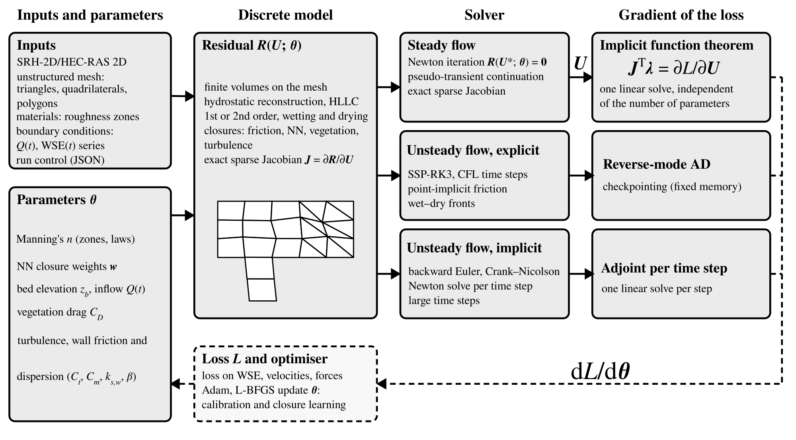

# Hydrograd v2.0

Differentiable finite-volume solver for the 2D shallow water equations (SWEs) and the Universal SWEs (SWEs with neural-network as closures), written in Python with [JAX](https://github.com/jax-ml/jax). It runs on CPUs and GPUs in double precision and provides gradients of any output with respect to the model parameters, for calibration, inversion, sensitivity analysis and closure learning.

- **Input:** SRH-2D case files (`.srhhydro`, `.srhgeom`, `.srhmat`) and a JSON run-control file. HEC-RAS 2D meshes can be converted to SRH-2D files with [pyHMT2D](https://github.com/psu-efd/pyHMT2D).
- **Modes:** forward simulation, sensitivity analysis, inversion (Manning's n, bed elevation, inflow hydrograph, exit stage, vegetation and porous drag) and closure learning (USWEs).
- **Solvers:** explicit (SSP-RK3, Tsit5) with checkpointed reverse-mode gradients; steady Newton with an exact sparse Jacobian and implicit-function-theorem gradients; implicit backward Euler / Crank–Nicolson with per-step adjoints.
- **Hardware:** CPU and GPU (JAX, float64).



*Overview of Hydrograd v2.0. Inputs and parameters define the discrete residual on the unstructured mesh; the state is computed by steady Newton iteration, explicit or implicit time stepping; each solver has a matching gradient method (implicit function theorem, checkpointed reverse-mode AD, per-step adjoint), and the gradient of the loss drives the calibration or closure learning.*

**Documentation:** the user manual is [`docs/manual.md`](docs/manual.md). The scripts and data of the model description paper (Liu, *Hydrograd v2.0:  differentiable shallow-water modelling on unstructured meshes*, in preparation), which reproduce every figure, are in [`paper/`](paper/). Licence: MIT ([`LICENSE`](LICENSE)); citation: [`CITATION.cff`](CITATION.cff).

Hydrograd v2.0 succeeds [Hydrograd.jl](https://github.com/psu-efd/Hydrograd.jl) (v1.0, Julia; Liu & Song 2025, *Water Resources Research*, doi:10.1029/2025WR040265). It keeps the same case files and run-control format, so v1.0 cases run unchanged.

## Install

```bash
uv pip install -e ".[dev]"            # CPU
uv pip install -e ".[dev,cuda]"       # + JAX for CUDA 12 GPUs
uv pip install -e ".[pardiso]"        # optional: multithreaded sparse LU (faster steady and implicit solves)
```

Plain `pip install` works the same way. Heavy runs (large meshes, GPU runs, the paper's performance tables) are meant for a cluster or a workstation with an NVIDIA GPU; the package itself has no cluster-specific code.

## Run a case

A case is a folder with the SRH-2D files and a `run_control.json`. Inside it:

```bash
hydrograd run            # mode chosen in run_control.json: forward simulation, inversion, sensitivity analysis or UDE
```

The cases of the paper (Savannah River steady, inversion and unsteady calibration; transcritical bump; hydrograph inversion; flood wave) are in [`paper/cases/`](paper/cases/), with a README that maps each folder to its section of the paper; the closure-learning cases are in `paper/data/fig06_steady_ude/`. **Copy a case folder before running it:** a forward run writes `forward_simulation_solution_truth.json` and would overwrite the truth file of the example.

**Outputs:**
- `forward_simulation_results_%04d.vtk` (binary above 20k cells; open in ParaView);
- truth and result JSON files;
- loss-history CSVs.

### Run-control options

The run-control format and every option are described in [`docs/manual.md`](docs/manual.md). The main blocks:

**Numerics**, a top-level block (all keys optional):

```json
"numerics": {
  "scheme": "hr_hllc",            // hydrostatic reconstruction + HLLC (wet/dry); or "julia_xi_roe" (the v1.0 scheme, wet domains only)
  "spatial_order": 2,             // 1 is ~6x faster on wet/dry transients but more diffusive
  "limiter": "venkatakrishnan",   // or "barth_jespersen" (sharper, but stalls steady convergence)
  "checkpoints": 64,              // or "auto": as many as fit in checkpoint_memory_gb
  "checkpoint_memory_gb": 2.0
}
```

**`ode_solver`** values:
- `SSPRK3()`: wet/dry runs. CFL-limited steps, positivity-preserving, point-implicit friction.
- `Tsit5()`, `RK4()`, `Euler()`: adaptive or fixed-step explicit integration of wet domains.
- `SteadyNewton()`: steady state by Newton with implicit-function-theorem gradients. Requires the wet extent not to change during the solve.
- `BackwardEuler()` / `CrankNicolson()`: implicit θ-scheme with a fixed step `time_settings.dt` (tens of seconds) and per-step IFT gradients (reverse mode). Best for long, slowly varying, mostly wet events; large steps at fast-advancing wet fronts can fail.

**Time series:** `IQParams` and `EWSParamsC` in `.srhhydro` accept an SMS/SRH-2D `.xys` file (times in hours) in place of a number. The series are differentiable, so hydrographs can be inverted.

**Vegetation drag:** an optional top-level `vegetation` block adds the drag of rigid emergent stems, ½ C_D a h |u| u per unit plan area (a = d/ΔS², the frontal area per unit volume). It acts as an extra friction rate ½ C_D a |u|, so every solver and adjoint includes it.

```json
"vegetation": {
  "a":  {"2": 1.0},         // 1/m, per material ID (or "d" and "spacing" in m, per material)
  "CD": {"2": 1.0}          // drag coefficient per material ID
}
```

- **Inversion and sensitivity:** `active_param_names: ["veg_CD"]` makes the drag coefficient per material zone the active parameter.
- **UDE:** `UDE_choice: "VegetationCD"` trains a local network C_D = f(h, |u|, a), with `input_dim` 3 and `a_bounds` in `UDE_NN_config`. Manning's n stays per zone for the bed.
- **Force data:** a `force_data` block (`file`, `sigma_N`, `weight`) adds observed drag forces on regions (material zones, boxes or cell lists) to the inversion and UDE losses. Flow fields alone do not identify how resistance is split between neighbouring patches; patch or sub-patch forces do.
- **Order of accuracy:** use second order (the default) for deep, slow vegetated flows. On a sloping bed, first-order hydrostatic reconstruction adds a numerical flux of about √(gh) S dx/2.

**Porous drag (Darcy–Forchheimer):** an optional `porous` block adds (α + β|u|) u h per unit plan area, the porous-media option of SRH-2D and HEC-RAS. Give `alpha` (1/s) and `beta` (1/m) per material ID, or `porosity` and `d` (m), from which Ergun's equation gives them. `active_param_names: ["porous_alpha"]` or `["porous_beta"]` inverts them, and force data include this drag.

**Scattered velocity data (LSPIV):** an optional `velocity_data` block reads scattered velocities from CSV or PIVlab ASCII files. It maps them to model coordinates, converts surface velocities to depth averages (`surface_factor`), averages them over the cells that contain them, and adds the misfit on those cells to the inversion and UDE losses. See `docs/manual.md`, Sect. 7.1.

**UDE network:** the closure is a local law n_i = f(h_i); `UDE_NN_config.layernorm` defaults to false.

## Python API (sketch)

```python
import hydrograd
from hydrograd.io.control import read_control
from hydrograd.apps.setup import setup_case
from hydrograd.solvers.ode import solve_swe
from hydrograd.solvers.implicit import ImplicitSettings, solve_implicit

case = setup_case(read_control("run_control.json"))
sol = solve_swe(case.model, {}, case.U0, case.ode)                  # explicit
ts, ys = solve_implicit(case.model, {"Q": q}, case.U0,              # implicit backward Euler
                        ImplicitSettings(0.0, 7200.0, 60.0, n_save=24))
# jax.grad of any loss of ys w.r.t. theta ({"n_zone", "zb", "Q", "WSE", "nn"}) works with every solver.
```

## Why JAX

PyTorch and JAX were both prototyped (`benchmarks/backend/`) and benchmarked on the same residual, meshes and hardware before the package was written.

- **Speed:** on an NVIDIA A100 in float64, JAX was faster than `torch.compile` at every mesh size from 2k to 512k cells. Forward runs were 1.2–5× faster and reverse-mode gradients 2–11× faster.
- **Why:** XLA compiles the whole time loop (`lax.scan`) into one program, while PyTorch pays a per-step Python dispatch cost, most of all in the checkpointed backward pass.
- **Solver tools:** JAX's `custom_vjp`, `jvp`/`vmap` and checkpointing support the implicit-function-theorem adjoints and the coloured sparse Jacobians that the steady and implicit solvers are built on.

Peak GPU memory was similar for both backends. The package uses JAX only.

## Validation

- **Exact solutions:** Stoker and Ritter dam breaks (L1 depth error 0.4–0.5 mm at second order); lake at rest with an emerged island (exact); subcritical flow over a bump (observed order 1.9).
- **SRH-2D:** Savannah River steady water surface within 6.3 mm RMS of SRH-2D.
- **Gradients:** checked against finite differences for every solver (explicit, steady IFT, implicit IFT), including across wetting fronts (`paper/gradient_checks.py`).
- **v1.0:** the semi-discrete residual matches Hydrograd.jl to round-off, and its sensitivity, inversion and UDE trajectories to 1e-4 to 4e-3.

The paper in `paper/` documents these checks in detail.

## Tests

```bash
pytest tests             # ~10 min on 8 cores (slow tests skipped)
pytest -m "" tests       # all tests (~25 min)
```

The tests that compare with v1.0 need a Hydrograd.jl checkout next to this folder or at `$HYDROGRAD_JL`; they are skipped otherwise.
